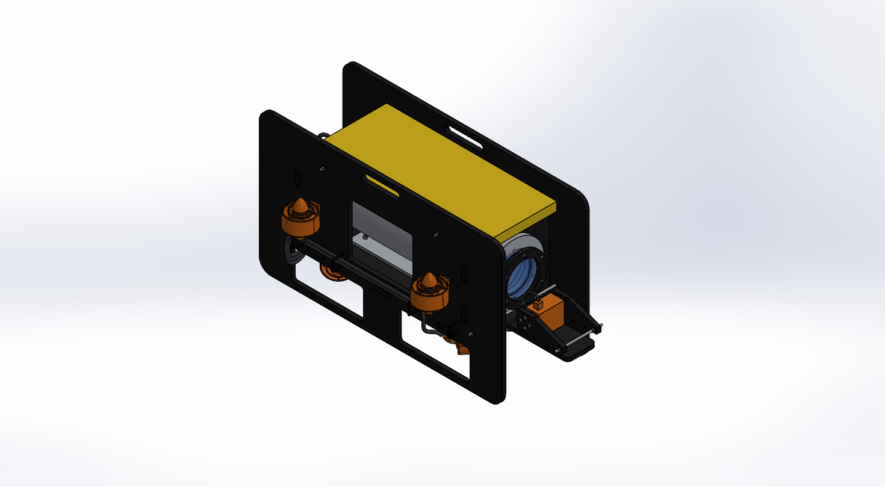

# swkit

SOLIDWORKSの設計を自動化するPythonライブラリ

設計者が後から開いて直せる 3次元モデルと，顧客へ提出できる設計文書を，同じ設計値から生成する．



上の組立モデルは [ai_assisted_submarine](https://github.com/waarrk/ai_assisted_submarine) で，設計値と形状の記述から全部品を生成したものである．

## 特徴

| 項目 | 内容 |
| --- | --- |
| 直せるモデル | 完全定義のスケッチ，名前付きの設計変数と関係式，加工工程ごとのフィーチャ |
| 規格に沿う形状 | JIS の穴ウィザード，フィレット，面取り，ミラー，円形・直線パターン，板金，円弧 |
| 組立からの設計 | レイアウトスケッチ，基準平面への合致，組立状態で定義して各部品へ反映する共締め穴 |
| 実物の購入品 | 製造元の配布データの取り込み，MISUMI RAPiD Design からの型番指定の取り込み |
| 確認の自動化 | 拘束状態，干渉，質量と重心，断面の画像，使われていない基準平面とスケッチの点検 |
| 正式文書 | 原稿から Word と PDF を生成．表紙，改訂履歴，目次，図表番号，数式，用語集，文書管理台帳 |
| 導入 | コマンド 1つで設定と点検．Claude Code 用の設計者スキルを同梱 |

## 導入

Windows，SOLIDWORKS，Python 3.10 以上が必要である．SOLIDWORKS 2024 で動作を確認した．

```text
git clone https://github.com/waarrk/swkit.git
python -m venv .venv
.venv\Scripts\pip install -e swkit[rapid,doc]
.venv\Scripts\swkit setup
```

`swkit setup` は，SOLIDWORKS の版とテンプレートを調べて設定ファイルを作り，設計者スキルを入れ，環境を点検する．詳細は [導入](docs/01_導入.md) に示す．

## 最初の設計

```text
.venv\Scripts\swkit new 試作治具 --code JIG01
cd 試作治具
..\.venv\Scripts\python src\試作治具\build.py
..\.venv\Scripts\python -m swkit.docgen doc\03_設計\JIG01-DDS-001_詳細設計書.md
```

1行目で設計プロジェクトの骨組みができる．3行目で見本の部品 2点と組立モデルを生成し，4行目で詳細設計書のひな形を Word と PDF にする．

形状は次のように書く．寸法は設計変数の名前の式で与え，SOLIDWORKS の関係式として残る．

```python
import types
from swkit import SW

P = types.SimpleNamespace(W=120.0, H=80.0, T=10.0, RIM=15.0)
sw = SW(P)
try:
    p = sw.new_part()
    s = p.sketch("front")
    s.rect("-W / 2", "W / 2", "-H / 2", "H / 2")
    p.extrude_mid("T", "板")
    s = p.sketch("front")
    edges = s.convert([(0, "H / 2", "T / 2"), ("W / 2", 0, "T / 2"),
                       (0, "-H / 2", "T / 2"), ("-W / 2", 0, "T / 2")], construction=True)
    s.offset(edges, "RIM", toward=(0, 0))
    p.cut_through("窓")
    p.save_as("plate.SLDPRT")
finally:
    sw.restore()
```

## 文書

| 文書 | 内容 |
| --- | --- |
| [導入](docs/01_導入.md) | インストール，設定，環境の点検 |
| [設計の進め方](docs/02_設計の進め方.md) | プロジェクトの構成，設計値，組立からの設計の手順 |
| [モデルの書き方](docs/03_モデルの書き方.md) | スケッチ，フィーチャ，組立，共締め穴の書き方 |
| [購入品](docs/04_購入品.md) | 配布データの取り込み，RAPiD Design，既存の部品の登録 |
| [正式文書](docs/05_正式文書.md) | 原稿の書式，文書番号，Word と PDF の生成 |
| [点検と速度](docs/06_点検と速度.md) | モデルの点検，所要時間の計測，部品とユニットの使い回し |
| [困ったとき](docs/07_困ったとき.md) | 症状ごとの原因と対処 |
| [API 一覧](docs/api.md) | 全モジュールの関数とメソッド |
| [モデリング規約](src/swkit/templates/skill/MODELING_RULES.md) | 生成するモデルが従う決まり |

## 注意

- SOLIDWORKS を操作するスクリプトを 2本同時に実行しない．
- 生成先のフォルダにある文書は上書きする．手で直した内容は設計値か生成スクリプトへ反映する．
- 生成中は画面更新と視点のアニメーションを止める．終了時に `sw.restore()` で元へ戻す．
