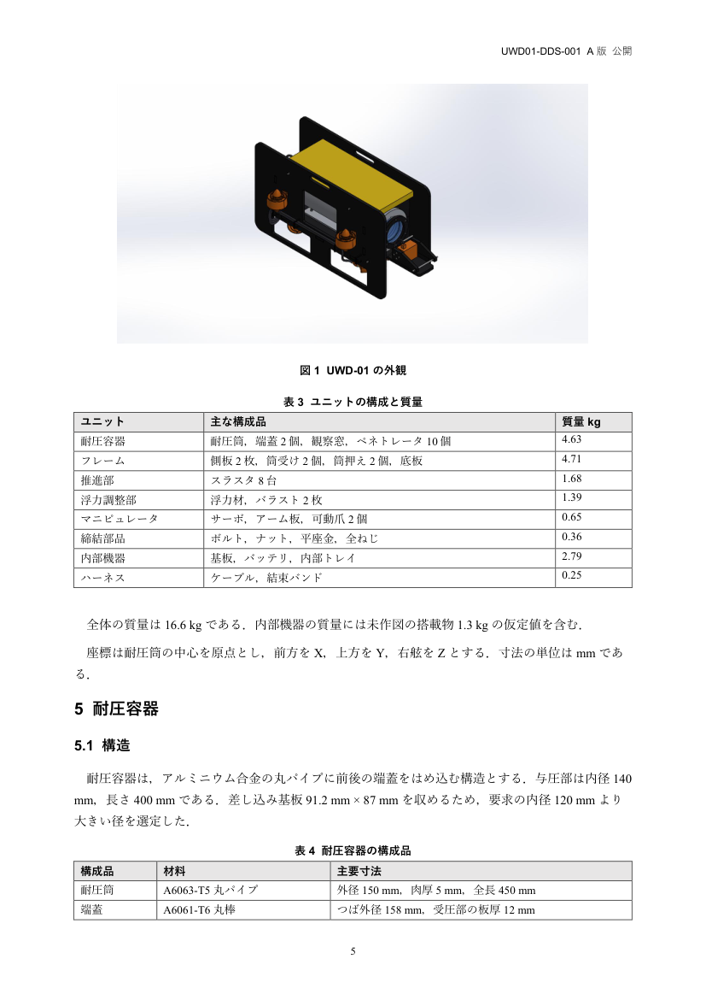

# 正式文書

顧客へ提出する文書は，Markdown の原稿から Word と PDF を生成する．文書番号は台帳で管理する．



## 1. 生成

```text
python -m swkit.docgen <原稿.md> [<原稿.md> ...]
```

`<文書番号>_<版>.docx` と `.pdf` を `doc/09_提出/` に出力する．PDF は Word で書き出すため，目次のページ番号が入る．

## 2. 文書番号と台帳

文書番号は `doc/00_管理/文書管理台帳.csv` に登録してから使う．形式は「案件記号-種別-連番」である．

| 種別 | 対象 | 保管フォルダ |
| --- | --- | --- |
| MGT | 管理要領 | 00_管理 |
| PLN | 設計開発計画書 | 01_計画 |
| REQ | 要求仕様書 | 02_要求 |
| DDS | 詳細設計書 | 03_設計 |
| CAL | 計算書，検討書 | 03_設計/計算書 |
| DRR | 設計審査記録 | 04_審査 |
| VER | 設計検証記録 | 05_検証 |
| VAL | 妥当性確認の計画書と記録 | 06_妥当性確認 |
| ECN | 設計変更記録 | 07_変更 |
| BOM | 部品表 | 08_購買/部品表 |

生成時に，原稿の文書番号，名称，版を台帳と照合する．番号が未登録の場合，名称が違う場合，改訂履歴の最後の版が文書の版と違う場合は中止する．生成後は台帳の版，発行日，状態，原稿と提出物の場所を更新する．状態は，承認者が空なら「審査前」，記入済みなら「発行」になる．

## 3. 原稿の書式

原稿の先頭に，`+++` で囲んだ TOML の文書情報を置く．

```toml
+++
number = "JIG01-DDS-001"
title = "試作治具 詳細設計書"
version = "A"
date = "2026-11-25"
author = ""
reviewer = ""
approver = ""
organization = ""
confidentiality = "社外秘"

[[revision]]
version = "A"
date = "2026-11-25"
content = "初版"
author = ""

[[glossary]]
term = "共締め穴"
meaning = "相手部品と同じ位置に開ける締結用の穴"
where = "3章"
+++
```

本文で使える書き方は次のとおりである．

| 書き方 | 出力 |
| --- | --- |
| `# 章`，`## 節`，`### 項` | 番号付きの見出し．番号は自動 |
| 段落 | 字下げした本文 |
| `- 項目`，`1. 項目` | 箇条書き，番号付きの箇条書き |
| `表: 題名 {#tbl:名前}` の次の行からの表 | 番号と題名の付いた表 |
| `{#fig:名前}` | 番号と題名の付いた図 |
| `$$ 式 $$ {#eq:名前}` | Word の数式．右端に式番号 |
| `@tbl:名前`，`@fig:名前`，`@eq:名前` | 「表 2」「図 1」「式 (1)」への置き換え |
| `付録` で始まる章 | 付録 |

式では，`\mathrm{sin}` で立体，`\overline{BG}` で上線，`\theta` などでギリシャ文字，`x_{ab}` と `x^{2}` で下付きと上付きを書く．`\log`，`\sin` などの関数名は立体になる．変数は斜体になる．文中の式は `$式$` で書く．

## 4. 体裁

| 箇所 | 内容 |
| --- | --- |
| 用紙 | A4 縦 |
| 表紙 | 題名，文書番号，版，発行日，発行元，機密区分，作成・審査・承認，改訂履歴 |
| 目次 | 章と節．ページ番号付き |
| ヘッダ | 文書番号，版，機密区分 |
| フッタ | ページ番号 |
| 付録 | 文書情報の glossary から作る用語集 |
| 書体 | 本文は游明朝 10.5 pt，見出しと表の見出し行は游ゴシック |

## 5. 提出前の確認

1. 原稿を日本語の機械検査に掛け，検出を 0件にする．
2. 生成する．
3. PDF を開き，表紙，目次のページ番号，表の幅，図，式を目視で確認する．
4. 審査者と承認者を記入して再生成する．

詳細設計書には，要求事項ごとに設計値と根拠の箇所を対応させる表を置く．未確定事項と制約の章を必ず置く．相手へ出す文書には，スクリプト名やリポジトリの話を書かない．
